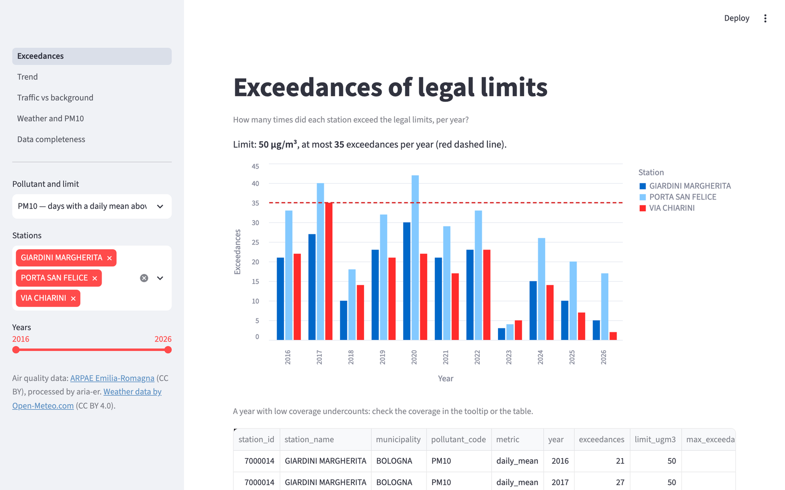
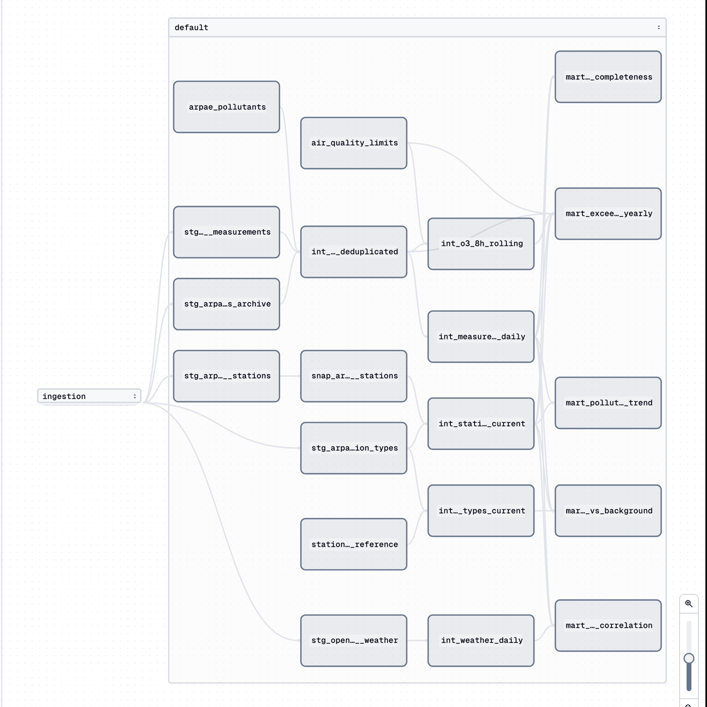

# aria-er

[](https://github.com/CieriS/aria-er/actions/workflows/rust.yml)
[](https://github.com/CieriS/aria-er/actions/workflows/python.yml)
[](https://github.com/CieriS/aria-er/actions/workflows/dbt.yml)

End-to-end data platform for air quality in Emilia-Romagna, Italy, built on
[ARPAE](https://www.arpae.it) open data and enriched with weather data from Open-Meteo.

## Why

ARPAE publishes air quality measurements across dozens of monitoring stations,
but the data is split across yearly files and APIs, and recent measurements are
provisional and revised after validation. aria-er turns this into a clean,
historized and tested dataset that answers questions like:

- How many days did each station exceed the legal PM10 limit this year?
- How much does traffic contribute compared to background pollution in the same area?
- How much of a pollution peak is explained by weather (wind, rain)?
- Is air quality actually improving over the years?

## What it demonstrates

- **Idempotent, incremental ingestion** written in Rust, handling late-arriving
  and revised data through windowed reprocessing and upserts
  ([why Rust](docs/decisions.md#phase-1--rust-ingestor), given that the job waits on the network)
- **Layered modeling** with dbt (staging → intermediate → marts), including
  SCD Type 2 history for monitoring stations
- **Data quality as code**: uniqueness, completeness and freshness tests
- **Orchestration** with Dagster: schedules, backfills, asset lineage
- **Reproducible infrastructure**: Docker Compose locally, Terraform on GCP
- **CI** on every pull request across Rust, Python and dbt

## Status

**It runs.** On a machine with only Docker, `make up` on a fresh clone ingests ten years of
measurements and the last 30 days, builds and tests the marts and serves the dashboard, in
about six minutes (last checked on a clean clone on 2026-10-12). Measurements stop on
2026-10-09: ARPAE has not updated its archive since
([#40](https://github.com/CieriS/aria-er/issues/40)).

**Not done:** the Google Cloud target is implemented and tested on an emulator, but has never
run on a real project ([docs/cloud.md](docs/cloud.md)). What is approximate or manual is in
[docs/limitations.md](docs/limitations.md).

| Dashboard, after `make up` | Dagster asset lineage |
|---|---|
|  |  |

## Quick start

With Docker only:

```bash
make up      # Dagster on http://localhost:3000, dashboard on http://localhost:8501
make down
```

On a fresh clone the stack loads its own data; after about six minutes the dashboard shows
ten years of measurements. Without Docker (Rust toolchain, [uv](https://docs.astral.sh/uv/)
and `make`):

```bash
make ingest       # ARPAE measurements, weather and the archive into raw/
make transform    # dbt build into warehouse/aria_er.duckdb
make dashboard    # Streamlit on http://localhost:8501
make lint && make test
```

All commands and options: [docs/running.md](docs/running.md).

## What the data says

Checked against ARPAE's own reports ([details](docs/transformations.md)):

- **Exceedances**: PM10 exceedance days of the Bologna stations match the ARPAE report for
  every year from 2016 to 2025; in 2025 one station in the region is above the 35 allowed
  days (Modena – Giardini, 40), as in ARPAE's regional summary.
- **Current year**: for 2026 the exceedances counted since 1 January equal ARPAE's daily
  bulletin of 8 October for every station it lists: PM10 days at 64 stations, NO2 hours at
  65, ozone days at 43.
- **Traffic**: in 2025 NO2 at traffic stations is 5 to 16 µg/m³ above the background of the
  same city; PM2.5 shows no difference.
- **Weather**: in winter PM10 falls with wind at 41 of 42 stations (correlation −0.39 on
  average); rain matters much less ([details](docs/weather.md)).

## Architecture

```
ARPAE API/CSV ─┐
               ├─► ingestor (Rust) ─► raw/ (Parquet, partitioned year/month)
Open-Meteo ────┘                          │
                                          ▼
                              DuckDB (local) | BigQuery (cloud)
                                          │
                                   dbt: staging ─► intermediate ─► marts
                                          │
                          Dagster (schedule, backfill, asset lineage)
                                          │
                                 Streamlit dashboard
```

Everything in the diagram runs locally; the BigQuery side has only run on an emulator.

## Documentation

| Topic | Document |
|---|---|
| Commands, outputs, raw schema, containers | [docs/running.md](docs/running.md) |
| Data sources and how their problems are handled | [docs/data.md](docs/data.md), [docs/data-exploration.md](docs/data-exploration.md) |
| dbt models, rules, checks against ARPAE reports, legal limits | [docs/transformations.md](docs/transformations.md) |
| Weather source and the PM10–wind result | [docs/weather.md](docs/weather.md) |
| Dagster assets, partitions, schedule, sensor, checks | [docs/orchestration.md](docs/orchestration.md) |
| Dashboard pages and structure | [docs/dashboard.md](docs/dashboard.md) |
| CI workflows, fixtures, branch protection | [docs/ci.md](docs/ci.md) |
| Google Cloud: setup, cost, teardown | [docs/cloud.md](docs/cloud.md) |
| Design decisions by phase and ADR index | [docs/decisions.md](docs/decisions.md), [docs/adr/](docs/adr/) |
| Known limitations | [docs/limitations.md](docs/limitations.md) |

## Roadmap

- [x] **0. Exploration** — one year of Bologna data, schema and quality issues documented
- [x] **1. Minimal Rust ingestor** — ARPAE → partitioned Parquet, idempotent, tested
- [x] **2. dbt on DuckDB** — staging + `mart_exceedances_yearly` with tests
- [x] **3. Orchestration** — Dagster daily schedule and backfills
- [x] **4. Second source** — Open-Meteo + `mart_weather_correlation`
- [x] **5. Dashboard** — Streamlit
- [x] **6. Full CI** + Docker Compose
- [ ] **7. Cloud** — GCS + BigQuery via Terraform, same dbt models with a different target
  (code, Terraform and CI ready; the end-to-end run on GCP is still to do)
- [x] **8. (Optional) Streaming** — evaluated and not built: the sources are daily batches
  ([ADR 0007](docs/adr/0007-no-streaming.md))

A phase is done when it works end-to-end, has tests, and the documentation is updated.

## Repository layout

```
data/samples/arpae/   raw samples downloaded in phase 0 (source of the test fixtures)
docs/                 documentation by area, data exploration report, ADRs
ingestor/             Rust workspace
  config/             default configuration
  crates/core/        domain models, Source/Sink traits, errors
  crates/http/        HTTP transport with timeouts and retry
  crates/source-arpae/  ARPAE client and parsing
  crates/source-openmeteo/  Open-Meteo archive client and parsing
  crates/sink-parquet/  partitioned Parquet writer with upsert
  crates/cli/         aq-ingest binary
transform/            dbt project (DuckDB): staging, intermediate, marts, seeds, snapshot, tests
orchestration/        Dagster project: assets, checks, schedule, resources, tests
dashboard/            Streamlit app: data access, charts, pages, tests
scratch/              throwaway exploration scripts
docker/               Dockerfiles for ingestor, orchestration and dashboard
docker-compose.yml    local stack
infra/                Terraform for GCP: bucket, BigQuery datasets, service accounts
Makefile              ingest / transform / orchestrate / backfill / dashboard / up / down / test / lint / cloud-*
```

## License and data

The code is released under the [MIT License](LICENSE).

The data are not mine and keep their own licences; both ask for attribution:

- **Air quality**: © ARPAE Emilia-Romagna, dataset
  [Qualità dell'Aria – Dati di monitoraggio](https://dati.arpae.it/dataset/qualita-dell-aria-rete-di-monitoraggio),
  published under Creative Commons Attribution (CC BY). The samples in `data/samples/` and the
  fixtures in `transform/fixtures/` and in the ingestor tests are excerpts of it; the marts are
  derived from it (units converted, values aggregated, suspicious values flagged).
- **Weather**: [Weather data by Open-Meteo.com](https://open-meteo.com/), under
  [CC BY 4.0](https://creativecommons.org/licenses/by/4.0/), from its historical archive.

The dashboard shows the same credits on every page.
